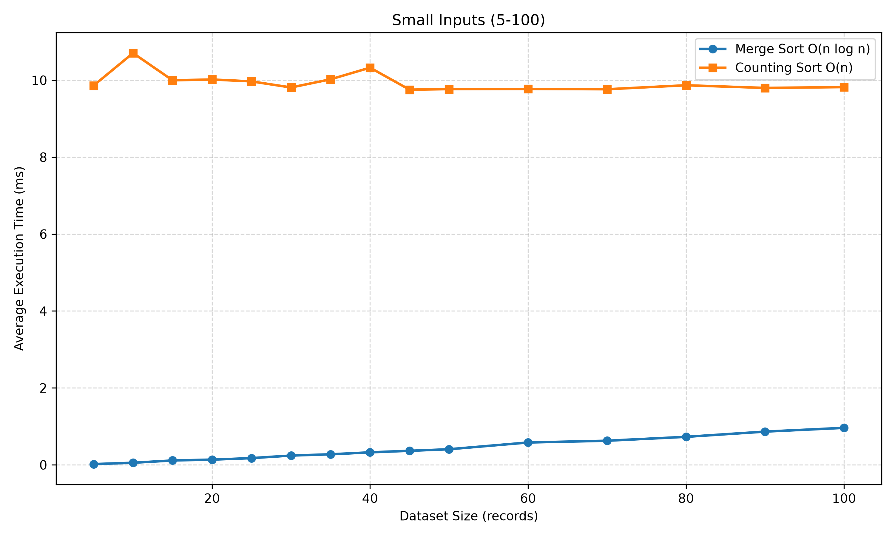
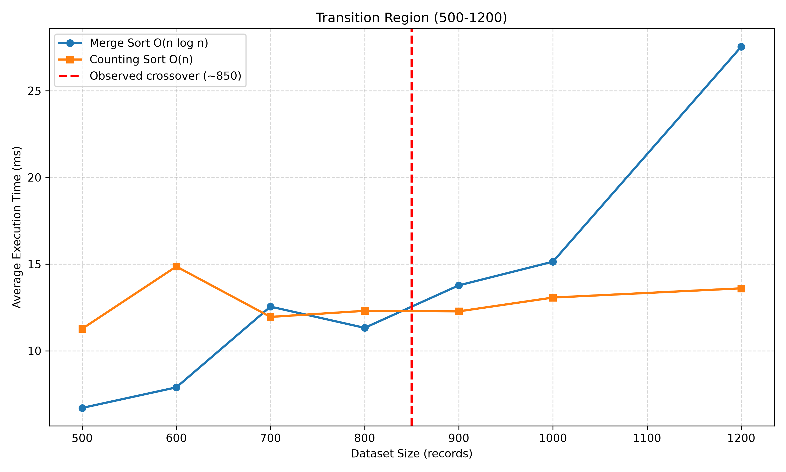
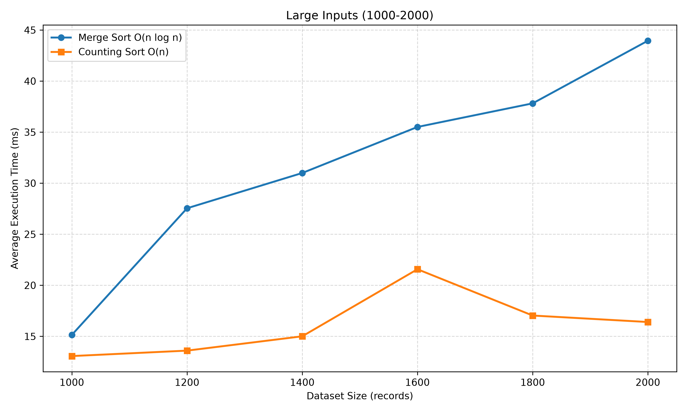
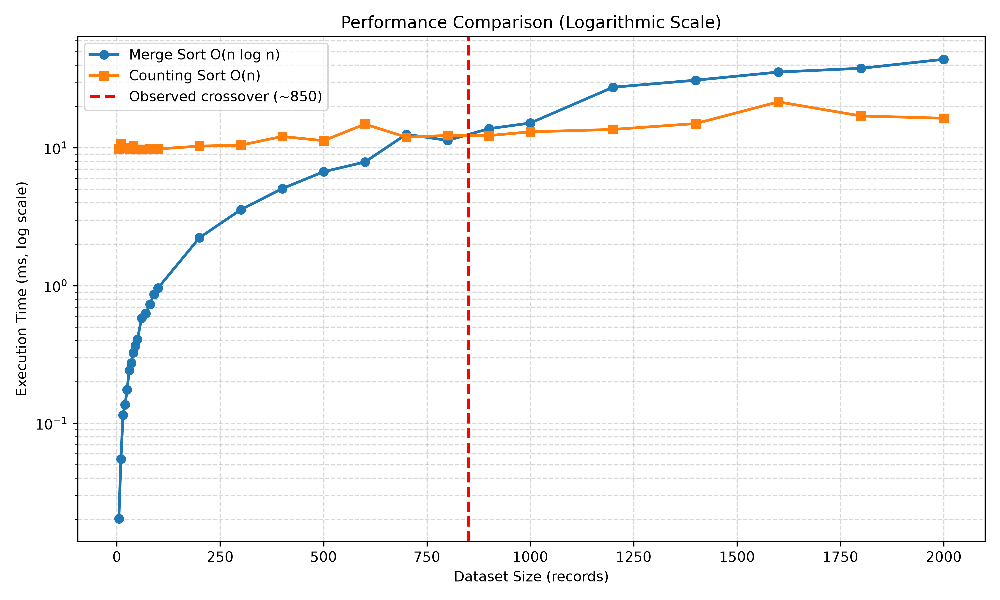

# Credit Card Record Matching

[](https://github.com/roslindesiredziele-hash/credit-card-record-matching/actions/workflows/ci.yml)

> University of Łódź • Algorithms I • Assignment I
>
> Comparison of Merge Sort (`O(n log n)`) and Counting Sort (`O(n + k)`) for reconstructing anonymized credit card records.

A C++ project that reconstructs complete credit card records from two anonymized data dumps and compares matching approaches based on asymptotic complexity and empirical performance.

---

## Overview

Two CSV files contain partial information describing the same set of credit cards.

- Dump 1 stores the first 15 digits of each card number.
- Dump 2 stores the last 4 digits together with card metadata.
- Both dumps are ordered according to expiration date and PIN.

The objective is to reconstruct complete card records and evaluate two different matching approaches:

1. **Merge Sort Based Matching** (`O(n log n)`)
2. **Counting Sort Based Matching** (`O(n + k)`)

The project combines algorithm design, complexity analysis, benchmarking, unit testing, and performance visualization.

---

## Dataset

Each record is represented as:

```cpp
struct CardRecord
{
    string cardNumber;
    string expiryDate;
    string verificationCode;
    string pin;
    string issuingNetwork;
};
```

The original dataset contains:

```text
20,000 records
```

Benchmark experiments are performed on subsets of the dataset ranging from **5 to 2,000 records** to analyze algorithmic behavior across different input sizes.

---

## Implemented Algorithms

### Merge Sort Based Matching

Records from both dumps are sorted using a custom Merge Sort implementation and then matched to reconstruct complete credit card records.

#### Time Complexity

```text
O(n log n)
```

#### Characteristics

- Comparison-based sorting algorithm
- Stable ordering
- No assumptions about key range
- Lower constant overhead
- Better performance on smaller datasets

---

### Counting Sort Based Matching

A composite integer key is created using the expiration date and PIN:

```cpp
CompositeKey = ExpiryKey * 10000 + PIN;
```

where

```cpp
ExpiryKey =
(year - 2024) * 12 + (month - 1);
```

The resulting composite key is then sorted using a custom Counting Sort implementation.

#### Time Complexity

```text
O(n + k)
```

where

```text
k = 720000
```

Because the key space is fixed, the implementation behaves approximately linearly with respect to input size.

#### Characteristics

- Non-comparison-based sorting algorithm
- Requires additional memory
- Large initialization cost due to the counting array
- Better scalability for large datasets

---

## Benchmarking Methodology

Execution time was measured using:

```cpp
QueryPerformanceCounter()
```

from the Windows API.

The following dataset sizes were benchmarked:

```text
5, 10, 15, 20, 25
30, 35, 40, 45, 50
60, 70, 80, 90, 100
200, 300, 400, 500, 600, 700, 800, 900, 1000
1200, 1400, 1600, 1800, 2000
```

For each size:

- A subset of records was selected from the original dataset.
- Both algorithms were executed repeatedly.
- Average execution times were recorded.
- Results were exported to a CSV file for later analysis.

---

## Experimental Results

The benchmark results highlight the difference between theoretical complexity and practical implementation costs.

### Key Observations

- For small datasets, Merge Sort generally performs better because it avoids the large fixed initialization cost required by Counting Sort.
- Counting Sort must allocate and initialize a counting array covering the entire key space (`k = 720000`) regardless of input size.
- As dataset size increases, the relative impact of this initialization cost decreases.
- Between approximately **800 and 900 records**, both algorithms achieve similar performance.
- Beyond this range, Counting Sort consistently outperforms Merge Sort.

The experimentally observed crossover point occurs at approximately:

```text
800–900 records
```

This behavior agrees with theoretical expectations. Although Counting Sort has a larger constant factor, its linear growth eventually dominates the logarithmic growth of Merge Sort for sufficiently large datasets.

---

## Testing

The project includes automated unit tests implemented using the **Catch2** testing framework.

### Test Statistics

- 12 test cases
- 18 assertions
- 100% passing tests

### Tested Functionality

The test suite verifies:

- Credit card number reconstruction
- Card comparison logic
- Expiry key generation
- Composite key generation
- Sorted-order validation
- Merge Sort correctness
- Counting Sort correctness
- Merge Sort based matching
- Counting Sort based matching
- CardRecord data integrity

### Running Tests

Build the project:

```bash
cmake -S . -B build
cmake --build build --config Release
```

Execute the test suite:

```bash
cd build
ctest -C Release --output-on-failure
```

Example output:

```text
Start 1: CreditCardRecordMatchingTests
1/1 Test #1: CreditCardRecordMatchingTests ... Passed

100% tests passed out of 1
```

Although CTest reports a single executable, that executable internally contains all Catch2 test cases and assertions.

### Continuous Integration

The repository uses GitHub Actions for Continuous Integration.

On every push and pull request, the workflow automatically:

- Configures the project with CMake
- Builds the project
- Executes the complete unit test suite

Workflow file:

```text
.github/workflows/ci.yml
```

---

# Generated Figures

All graphs are generated automatically from benchmark results stored in `data/data.csv`.

---

## 1. Small Inputs (5–100 Records)

<p align="center">
  
</p>

This graph focuses on small datasets where constant factors dominate performance.

### Observations

- Merge Sort consistently outperforms Counting Sort.
- Counting Sort spends most of its execution time initializing the counting array containing 720,000 entries.
- The asymptotic advantage of Counting Sort is not yet visible.

As a result, Merge Sort is the more efficient choice for small datasets despite its higher theoretical complexity.

---

## 2. Transition Region (500–1200 Records)

<p align="center">
  
</p>

This graph highlights the range where the performance of both algorithms begins to converge.

### Observations

- Merge Sort execution time grows steadily with input size.
- Counting Sort remains relatively stable because its running time is dominated by the fixed key-space size.
- The experimentally observed crossover occurs between approximately 800 and 900 records.
- The red dashed line indicates the observed crossover region.

This region demonstrates where asymptotic complexity begins to outweigh implementation overhead.

---

## 3. Large Inputs (1000–2000 Records)

<p align="center">
  
</p>

This graph focuses on larger datasets where asymptotic performance becomes the dominant factor.

### Observations

- Counting Sort consistently outperforms Merge Sort.
- Merge Sort follows the expected `O(n log n)` growth trend.
- Counting Sort exhibits near-linear growth.
- The performance gap widens as dataset size increases.

The results demonstrate the scalability advantage of Counting Sort for sufficiently large inputs.

---

## 4. Logarithmic Comparison (Full Dataset)

<p align="center">
  
</p>

A logarithmic y-axis is used to compare both algorithms across all tested dataset sizes.

### Observations

- Small execution-time differences become easier to visualize.
- The crossover point is clearly visible.
- Long-term scalability trends are easier to interpret.
- Both algorithms can be compared across the entire benchmark range on a single figure.

Using a logarithmic scale reveals performance relationships that are harder to observe on a standard linear plot.

---

## Setup

### Prerequisites

- C++17 compatible compiler
- CMake 3.10+
- Python 3.13+ (for graph generation)

### Clone the Repository

```bash
git clone https://github.com/roslindesiredziele-hash/credit-card-record-matching.git
cd credit-card-record-matching
```

---

## Build

### Configure

```bash
cmake -S . -B build
```

### Build

Debug:

```bash
cmake --build build
```

Release:

```bash
cmake --build build --config Release
```

Build artifacts:

```text
build/Debug/CreditCardRecordMatching_TDD.exe
```

or

```text
build/Release/CreditCardRecordMatching_TDD.exe
```

depending on the selected configuration.

---

## Usage

### Run Unit Tests

```bash
cd build
ctest -C Release --output-on-failure
```

### Run Catch2 Directly

```bash
build/Release/CreditCardRecordMatching_TDD.exe
```

List all available test cases:

```bash
build/Release/CreditCardRecordMatching_TDD.exe --list-tests
```

Display detailed test output:

```bash
build/Release/CreditCardRecordMatching_TDD.exe -s
```

---

## Benchmark Output

Benchmark results are written to:

```text
data/data.csv
```

Format:

```csv
Size,MergeSortMs,CountingSortMs
5,0.020,9.860
10,0.055,10.706
...
```

---

## Generate Graphs

Install dependencies:

```bash
py -3.13 -m pip install pandas matplotlib
```

Generate graphs:

```bash
py -3.13 graph.py
```

Generated files:

```text
report/
├── small_inputs.png
├── transition_region.png
├── large_inputs.png
└── logarithmic_comparison.png
```

---

## Project Structure

```text
credit-card-record-matching
│
├── .github/
│   └── workflows/
│       └── ci.yml
│
├── data/
│   ├── carddump1.csv
│   ├── carddump2.csv
│   └── data.csv
│
├── report/
|   |── graph.py
│   ├── small_inputs.png
│   ├── transition_region.png
│   ├── large_inputs.png
│   └── logarithmic_comparison.png
│
├── external/
│   └── catch.hpp
│
├── src/
│   ├── CardRecord.h
│   ├── MatchingAlgorithms.h
│   └── MatchingAlgorithms.cpp
│
├── tests/
│   └── CreditCardRecordMatching_TDD.cpp
│
├── CMakeLists.txt
├── README.md
└── LICENSE
```

---

## Conclusion

Although Counting Sort has a linear asymptotic complexity, its implementation introduces a substantial constant overhead because20,000 entries must be initialized for every execution.

This cost dominates performance for small datasets, making Merge Sort the faster solution despite its higher theoretical complexity.

The benchmark results show that Merge Sort is generally more efficient for smaller inputs, while Counting Sort becomes increasingly advantageous as the dataset grows. The experimentally observed crossover occurs at approximately **800–900 records**.

Beyond this point, Counting Sort consistently outperforms Merge Sort, confirming the theoretical expectation that a linear-time algorithm eventually scales better than a log-linear algorithm when input sizes become sufficiently large.

Overall, the project demonstrates that asymptotic complexity alone is not enough to predict real-world performance. Constant factors, memory usage, and implementation details can significantly influence practical running times.

---

## Author

**Desire Roslin Dziele**  
Computer Science Student  
University of Łódź

---

## License

This project was developed as part of the **Algorithms I** coursework at the **University of Łódź** and is intended for educational purposes.

Licensed under the MIT License. See the `LICENSE` file for details.